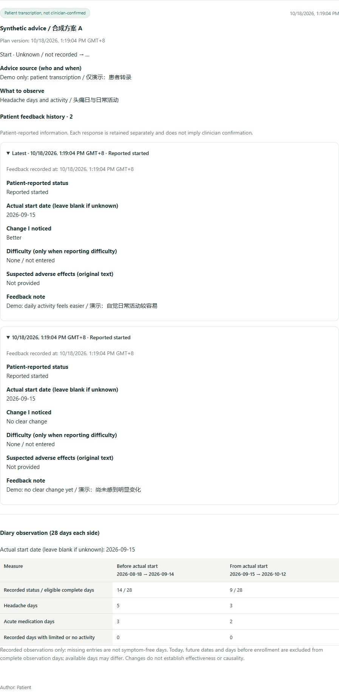
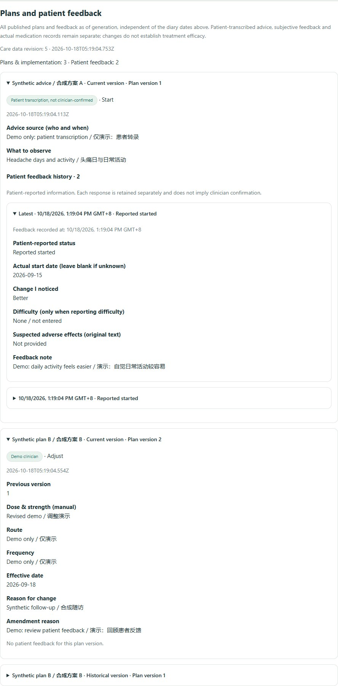

# Headache Diary Lab

**An eight-language, local-first research prototype for headache recording and clinician-readable follow-up.**

[简体中文 / Chinese](README.zh-CN.md) · **English documentation** · **0.6.1 experimental pre-release** · Node.js 24 · [Source-available license](LICENSE)

Headache Diary Lab connects daily status, headache episodes, medication use and reviewed voice-assisted input in one patient page. It produces reproducible summaries that show missing days and record coverage, alongside a simulated clinician workspace for assessments, treatment plans and follow-up.

This release is for synthetic-data demonstrations and engineering evaluation. Translations, model accuracy and clinical outcomes have not been independently validated. Email delivery and the hospital receiver are local simulations; mini-program folders are integration scaffolds.


## Feature highlight: one-click Windows launch, browser access, and optional mini-program and PWA entry points

**Make the diary easier for patients and clinicians to try and open.** The separately prepared Windows portable delivery offers one-click startup. The browser is the main interface; mini-programs and PWA are optional entry points, with different readiness levels.

| Entry point | Available now | Deployment or validation still needed |
| --- | --- | --- |
| **One-click Windows launch** | The full portable delivery includes its runtime and opens the browser on startup; local start/stop workflows have been verified. | This applies to the separately prepared Windows bundle. The GitHub source ZIP excludes the runtime and root launchers; source users need Node.js 24. |
| **Direct browser use** | Available on the host computer. Mobile users can choose browser access without a native app or PWA installation. | **Mobile access requires service deployment first.** This bundle currently accepts loopback access only; a reachable HTTPS service, deployment adaptations and real-device validation are still needed. |
| **Optional mini-program entry points** | Web-container integration scaffolds for WeChat, Alipay and Douyin are included. | Service deployment, platform builds, eligibility/approval, business-domain setup and real-device QR testing are pending. No mini-program is live. |
| **Optional PWA entry point** | Manifest, page caching and encrypted drafts are implemented. | Installation across target devices remains unverified. Mobile access needs deployment; a running backend is still required. Installation does not provide complete offline operation or activate real push notifications. |

See the [usage guide and readiness boundaries](docs/USER_GUIDE.zh.md#多入口使用亮点与当前范围) and [mini-program integration notes](miniapps/README.md). The portable delivery's Start Here pages provide device-specific instructions. The default local demo needs no separate database installation or speech-model download.

## What is new in 0.6.1

- **Readable feedback history:** inspect individual patient updates alongside their plan version, source and time; earlier feedback remains available when a plan changes.
- **Traceable clinician summaries:** generated summaries include treatment plans, adjustments and patient-reported responses as a snapshot. Existing reports retain the content available when generated; advice and feedback never become actual medication entries automatically.
- **A focused release:** the patient diary remains the core product. Clinician identities and plans are simulated; reminders and hospital delivery remain local demonstrations. No speech model or real clinical service is activated by this update.

See the [patient workflow](docs/PATIENT_WORKFLOW.md), [representative product comparison and release priorities](docs/PRODUCT_COMPARISON.md), and [version-specific validation](docs/VALIDATION.md). The comparison uses first-party sources and identifies useful design patterns; it does not claim global novelty or superior clinical outcomes. This project is source-available, not OSI-approved open source.

**0.6.1 verification:** 137 automated tests and 101 browser checks passed locally using isolated synthetic data. See [validation and boundaries](docs/VALIDATION.md).

### New workflow examples

| Individual feedback history | Clinician summary with plan and feedback snapshot |
| --- | --- |
| [](docs/screenshots/feedback-history-en-061.jpg) | [](docs/screenshots/clinician-summary-en-061.jpg) |

These examples use synthetic information. See [screenshot provenance](docs/screenshots/README.md); they demonstrate the interface and do not establish clinical effectiveness.

## Patient-centered changes in 0.6.0

This product is a **patient headache diary**, not a full medical chart, progress-note system or prescription engine. Patients can transcribe advice already received, identify its source, amend it without overwriting the original, and report their actual start, perceived changes or difficulty. Patient transcription remains visibly separate from simulated clinician confirmation; neither creates an actual dose entry.

An actual start date enables a 28-day-before/28-day-after diary view with complete-day eligibility and missing-record counts. This is descriptive observation, not a treatment-effect or causal conclusion. Voice candidates can be accepted or excluded individually; planned/advised/historical medication language is conservatively left for manual review. Rejected or unknown doses/units are not silently filled.

**Speech models remain optional interfaces only. No model, Python speech environment or cloud credential is included or enabled.** Text-based review works without them. See [patient workflow and limits](docs/PATIENT_WORKFLOW.md).

## Feature highlight: patient-controlled reminders

**Reminders that fit the patient's routine, designed to support continued diary use.** Patients choose the days, daily time and time zone, message language and content, and can adjust or disable the plan in Settings → Reminders.

- **Personalized with fewer interruptions:** quiet hours, pause dates, skipping completed daily check-ins and per-day deduplication reduce unnecessary repeat prompts.
- **Separate from clinical sharing:** explicit opt-in, with contacts and reminder history encrypted locally and excluded from clinician summaries and clinical sharing.
- **Demonstrable and extensible:** test a saved plan and inspect its history; in-page notices, email, SMS, PWA, WeChat and Alipay have simulated channels with documented boundaries for future integration.

**Current status: every channel is a local simulation; no external messages are sent.** Real delivery requires provider setup, account binding and appropriate permission. Supporting continued use is a design goal; improved adherence and clinical outcomes have not been demonstrated. See [reminder behavior and integration boundaries](docs/REMINDERS.md).

**0.6.0 validation:** 122 automated tests and 71 browser checks passed locally with synthetic data. These are engineering checks, not clinical or model-accuracy validation. See [validation](docs/VALIDATION.md).

## What you can explore

- **One patient page:** daily status, pain location/quality, timing, symptoms, suspected triggers, acute medication, prevention and activity impact. Untouched starter forms do not become records.
- **Transparent summaries:** headache days, attacks and medication days remain separate. Missing/unknown responses, cross-midnight events, revisions and report periods have explicit rules.
- **Eight interface and report languages:** Chinese, English, Spanish, French, Russian, Arabic, Hindi and Urdu. Hindi is LTR; Arabic and Urdu are RTL. Changing the interface preserves existing reports and original notes.
- **Reviewed voice assistance:** record or upload original audio, retain it encrypted locally, and review Chinese/English text candidates before filling the diary. Optional local/cloud adapters are provided; models and credentials are not bundled.
- **Simulated care workflow:** assessment → simulated treatment plan → follow-up, with versioned confirmations and patient feedback. A proposed plan never automatically becomes an actual dose record.
- **Sharing experiments:** explicit consent, encrypted packets, a mock recipient, receipts, idempotent retries and revocation of future sharing. JSON export and a limited FHIR R4 example are included.
- **Patient-controlled reminders (feature highlight):** configure days, time zone, language, message, quiet hours and pause dates in Settings. All six channels use local simulation; no real messages are sent. [Integration boundaries](docs/REMINDERS.md).
- **Offline drafts:** encrypted browser drafts and retry queues after the first successful visit. A trusted local device is required; encryption does not protect an unlocked or compromised device.

## Patient and clinician workflow

| Workspace | How to use it |
| --- | --- |
| **My diary** | Review the overview, record the day's status, complete relevant episode and medication fields, then review and save the entry. Untouched starter forms are excluded. |
| **Voice entry** | Open the floating panel, record/upload audio or type Chinese/English text, then review proposed fields and their source text before applying them. Automatic transcription requires a configured adapter. |
| **Reports & follow-up** | Choose dates and a report language, generate a summary, and explore assessment → simulated treatment plan → follow-up in the simulated clinician workspace. |
| **Settings** | Manage language preferences, configurable simulated reminders, data export and the consent/receipt demonstration. The default demo does not send data to a real clinic. |

Use the language selector at the top of the page to change the interface. New reports follow that language unless a separate report preference or per-report choice is set. Existing reports and original free-text notes retain their own language.

## Get 0.6.1

Two clean local release assets are prepared and **await GitHub upload**. Once published, both will appear in the same `v0.6.1` Pre-release; no public download URL is asserted here.

| File | Choose this when |
| --- | --- |
| `headache-diary-windows-x64-0.6.1.zip` | You use Windows x64 and want one-click startup. Includes the runtime, Start/Stop launchers and Start Here guides; no global Node installation is required. |
| `headache-diary-source-0.6.1.zip` | You want source code or will configure your own environment. Requires Node.js 24 and excludes the portable runtime/launchers. |

Both assets exclude existing accounts, records, recordings and keys. Extract the complete Windows ZIP into a new writable folder, double-click `Start.cmd`, and choose **Try synthetic case**. Use `Stop.cmd` after saving. See [download and first-use steps](docs/WINDOWS_PORTABLE.md) and the [owner's publication checklist](docs/RELEASE_PARTICIPATION.md). Current local Windows checks do not establish compatibility with every device; mobile browser deployment, PWA installation and mini-program launch have the limits above.

## Help test the prototype

Interested users can try a few synthetic tasks and share usability, language or accessibility feedback. No coding experience or personal health information is needed; participation is optional and this is not a clinical trial. See the [bilingual invitation](docs/TEST_INVITATION.md) and [tasks and feedback template](docs/RELEASE_PARTICIPATION.md). Contact **Junhui Liu M.D.** at [junhuiliu1025@gmail.com](mailto:junhuiliu1025@gmail.com), or use the official repository's Issues after publication. Institutional and commercial evaluation still requires prior written authorization; the invitation does not waive the license.

## Quick start from source

Install **Node.js 24.x**. No npm runtime dependencies, database installation, API key or model download is required for the default demo.

```sh
node --version
npm test
npm run check:release
npm start
```

Open **http://127.0.0.1:8765** and choose **Try synthetic case** (体验合成病例). Each demo entry creates a separate synthetic account. Stop the terminal with Ctrl+C; local records persist in `../data/` by default. The server binds to loopback only. `.env.example` documents optional environment variables and is not loaded automatically.

The separately prepared Windows portable folder includes `Start.cmd`, `Stop.cmd`, `Test.cmd` and its own runtime. These launchers are not required for the GitHub source checkout. See the [Chinese user guide](docs/USER_GUIDE.zh.md).

## Five-minute synthetic walkthrough

1. Open the synthetic case and inspect **My diary**. For September 1–28, 2026 the fixed example has **23/28 recorded days, 8 headache days, 7 attacks and 5 acute-medication days**; coverage is **82.1%**.
2. Switch interface languages. View Hindi LTR and Urdu RTL; clinical codes and numerical results remain unchanged.
3. Open **Reports & follow-up**, select a period and generate a report. Choose a different report language if needed.
4. Enter the simulated clinician workspace to explore assessment, plan and follow-up; return to the patient view.
5. Try typed Chinese/English input in the voice panel, review its evidence and fill the form. Automatic transcription requires a configured adapter.

## Eight-language interface examples

All eight screenshots were captured from **0.6.1** on **2026-10-18**, using the same isolated synthetic patient overview, reporting period (September 1–28, 2026) and browser viewport. Each capture includes the header and complete overview card. Select an image to open the original.

Every language shows **8 headache days, 7 attacks, 5 acute-medication days, 23/28 recorded days and 82.1% coverage**. LTR means left to right; RTL means right to left. Arabic and Urdu use RTL, while Hindi uses LTR.

| Chinese · 简体中文 · `zh` · LTR | English · English · `en` · LTR |
| --- | --- |
| [](docs/screenshots/patient-zh-061.jpg) | [](docs/screenshots/patient-en-061.jpg) |

| Spanish · Español · `es` · LTR | French · Français · `fr` · LTR |
| --- | --- |
| [](docs/screenshots/patient-es-061.jpg) | [](docs/screenshots/patient-fr-061.jpg) |

| Russian · Русский · `ru` · LTR | Arabic · العربية · `ar` · RTL |
| --- | --- |
| [](docs/screenshots/patient-ru-061.jpg) | [](docs/screenshots/patient-ar-061.jpg) |

| Hindi · हिन्दी · `hi` · LTR | Urdu · اردو · `ur` · RTL |
| --- | --- |
| [](docs/screenshots/patient-hi-061.jpg) | [](docs/screenshots/patient-ur-061.jpg) |

**Scope:** All eight languages are available for interfaces and reports. Speech transcription and structured extraction currently provide Chinese/English adapters only, require a configured service, and keep human review in the loop. These screenshots demonstrate the interface; they are not evidence of native clinical translation approval or patient usability validation. See [capture details and reproduction](docs/screenshots/README.md) and [localization notes](docs/LOCALIZATION.md).

## Reproduce and inspect

`npm test` runs synthetic clinical, HTTP, access-control, localization, model-contract, offline and packaging regressions. `npm run check:release` checks current documentation versions, local links, source boundaries and offline assets. A Windows/Linux GitHub Actions workflow is provided; local success is not a claim that hosted CI has run.

Create a clean source ZIP with PowerShell (PowerShell 7 on Linux):

```powershell
pwsh -File scripts/package.ps1 -Destination ../headache-release
```

The destination must be new or empty and outside the source directory. Packaging fails if private/runtime material is mixed into the release inputs. After running the app, keep its `data/` outside the release checkout or package from a clean checkout. `SHA256SUMS.txt` covers the staged source and ZIP; `node scripts/verify-manifest.mjs ../headache-release` checks for missing, modified or extra files.

[Short GitHub descriptions and suggested topics](docs/GITHUB_ABOUT.md)

| Read next | Purpose |
| --- | --- |
| [Project report](docs/PROJECT_REPORT.md) / [implementation status](docs/IMPLEMENTATION_STATUS.md) | Clinical design, actual scope and unfinished work |
| [Data dictionary](docs/DATA_DICTIONARY.md) / [architecture](docs/ARCHITECTURE.md) | Definitions, provenance, storage and API boundaries |
| [Voice](docs/VOICE_INTEGRATION.md) / [model adapters](docs/MODEL_INTEGRATION.md) | Supported contracts, consent and manual review |
| [Localization](docs/LOCALIZATION.md) | Eight catalogs, directions and pending translation review |
| [Validation](docs/VALIDATION.md) / [release checklist](docs/RELEASE_CHECKLIST.md) | Evidence and release gate |
| [Contributing](CONTRIBUTING.md) / [security](SECURITY.md) / [notices](NOTICE.md) | Contribution, disclosure and licensing |

## Limits and next steps

Independent clinical-rule review, native-language review, patient comprehension testing, accessibility evaluation and security review remain pending. Chinese/English speech and model contracts have been tested with simulated responses, not benchmarked with live providers. Hindi/Urdu interfaces do not imply Hindi/Urdu/Hinglish speech support. No diagnostic accuracy, treatment benefit or population-coverage claim is made.

Real email, hospital deployment and WeChat/Alipay/Douyin mini-program launch need separate implementation and validation. The simulated clinician identity is not professional verification, and simulated plans are not prescriptions. See the [research plan](docs/RESEARCH_PLAN.md) for measurable next steps.

Contributions using synthetic examples are welcome, especially clinical boundary cases, native-language review and accessibility feedback. Please describe actual evidence and preserve the distinction between implemented features, proposed work and validated outcomes.

## License and authorization

Copyright (c) 2026 **Junhui Liu M.D.** Personal noncommercial learning and experimentation are permitted under [LICENSE](LICENSE). **All institutional and commercial use requires prior written authorization**, including nonprofit institutional evaluation. Contact [junhuiliu1025@gmail.com](mailto:junhuiliu1025@gmail.com) or this project’s official GitHub repository when published. This is source-available, not OSI-approved open source. Third-party licenses and previously granted rights in older versions remain unaffected. See [licensing details](docs/LICENSING.md).
