# Headache Diary Lab · 头痛日记 · 0.8.2

## Android 离线患者版 0.1.0-preview

新增可首次离线启动的 Android 安装包：无需账号即可记录多日头痛，支持八语言、密码加密备份/恢复，联网后明确关联患者账号并主动同步至已部署的 HTTPS 服务。录音调用手机已有录音应用，没有可用应用时可选择已有音频；不捆绑识别模型。现有浏览器和 PWA 版本保留。

[安装、备份、同步与真机验收说明](docs/ANDROID_OFFLINE.md) · [八语言 Android 界面](docs/ANDROID_SCREENSHOTS.md)。当前0.8.2 / Android 0.1.0-preview候选尚未发布GitHub；旧版Release与CI不代表本轮验证。**真机验收安排在实验预发布后进行，当前尚未真机验证。** 见[本版发布说明](docs/RELEASE_NOTES_0.8.2.md)及[预发布后测试任务](docs/RELEASE_PARTICIPATION.md)。

## 0.8.2 登录入口与医生访问授权

登录页明确显示“患者登录”和“医生登录”，使用不同账号和密码；选择入口不会改变已登录账号的角色，也不会自动授予访问权限。合成体验位于患者登录表单下方，作为次要入口。

患者在 **设置 → 医生访问授权** 集中核对医生关联码、姓名、授权期限和范围，并查看或撤销已有授权。**医生建议与随访** 页只保留关联状态及“管理授权”快捷按钮；尚未关联时显示“关联我的医生”，点击会打开设置中的授权分区。医生建议、历史方案和患者反馈仍在该页查看。

八语言同步上述入口和文案，阿拉伯语及乌尔都语保持从右到左布局。医生注册仍须部署者审核；患者授权与医生登录均需连接服务。原账号、记录和授权关系保留。


> **0.8.2 本机评阅版，尚未发布到 GitHub。** 新增独立医生登录、部署者审核及患者可撤销授权，替代模拟身份切换。现有 v0.7.0 发布附件及 CI 结果仅对应 v0.7.0。账号设置、患者授权与审阅步骤见[医生入口指南](docs/CLINICIAN_ACCESS.md)。本工具不签发电子处方，也不验证医师执业资质。

**面向头痛记录与医患随访的八语言本地实验原型。**

简体中文 · [完整英文说明 / Full English README](README.md) · **0.8.2 本机评阅版** · Node.js 24 · [源码可见许可](LICENSE)

**既往公开的 0.7.0 版本：** [官方仓库](https://github.com/Alias1027/Multi-language-Headache-Diary--) · [Release与下载](https://github.com/Alias1027/Multi-language-Headache-Diary--/releases/tag/v0.7.0) · [自动检查](https://github.com/Alias1027/Multi-language-Headache-Diary--/actions)。本轮本机验证与既往发布结果分别见[验收记录](docs/VALIDATION.md)，历史0.6.1测试不等于本版验收。

本项目将每日状态、头痛发作、实际用药及经人工核对的语音辅助输入整合为一个患者页面，生成保留漏填信息与记录覆盖率的随访摘要，并提供独立账号与患者授权下的医生审阅、建议与随访工作区。

当前用于合成病例演示与工程验证。译文、模型准确性及临床结局尚未完成独立验证；邮箱和医院接收端为本地模拟，小程序目录为接口准备代码。


## 亮点：Windows一键启动、浏览器直接使用与可选小程序、PWA入口

**降低患者和医生的试用门槛，让记录入口更容易找到。** Windows便携交付包提供一键启动；浏览器是主要使用方式，小程序和PWA作为可选入口。各入口的当前状态如下，不代表全平台部署已完成。

| 入口 | 当前可用 | 待部署、待验证 |
| --- | --- | --- |
| **Android 离线患者版** | 独立 APK 首次启动无需网络或账号；八语言、多日记录、系统录音入口、加密备份与恢复。 | 本机研究预览，未发布应用商店或 GitHub；真机、换机及 HTTPS 同步仍待验收。 |
| **Windows一键启动** | 完整便携交付包含运行环境，双击启动并打开浏览器；本机启动/停止流程已验证。 | 此入口属于单独准备的Windows便携包；GitHub纯源码包不含运行环境和根目录启动入口，需先配置Node.js 24。 |
| **浏览器直接使用** | 电脑本机浏览器可用；手机可选择浏览器方式，无需下载手机APP或先安装PWA。 | **手机方式需先部署服务**：默认启动仍为电脑本机访问；本版新增可选HTTPS反向代理模式与配置示例，需维护者实际部署可访问的网址并完成真机验证。 |
| **可选小程序入口** | 已提供微信、支付宝、抖音网页容器入口准备代码。 | 待服务部署、平台构建、准入审核、业务域名配置及真机扫码验证；尚无已上线小程序。 |
| **可选PWA入口** | 已有应用清单（Manifest）、缓存页面及首次初始化后的加密多日离线队列。 | 各设备安装体验待验证，手机使用需先部署服务；安装后仍需后台服务，不等于完全离线应用，也不会自动启用真实推送。 |

使用步骤见[中文指南](docs/USER_GUIDE.zh.md#多入口使用亮点与当前范围)，小程序接入范围见[入口准备说明](miniapps/README.md)。便携交付中的“开始使用”页面提供设备指引。默认本机演示无需另装数据库或语音模型。

## 沿用自0.7.0：网络中断时仍可持续记录

- **多日离线记录：** 首次在线登录并完成缓存后，可连续记录不同日期及修订当天内容。待同步内容在当前浏览器中加密保存并明确展示，不冒充已入库记录。
- **可恢复同步：** 固定操作标识、顺序重试、账号核对、会话过期恢复及明确的冲突提示，防止重复提交与静默覆盖；必要时可导出待同步记录人工核对。
- **弱网适应：** 缓存静态页面优先使用，请求有超时边界。生成或共享报告前需同步；语音服务、方案反馈等仍需连接服务。
- **手机部署基础：** 新增限定网址的HTTPS反向代理模式和Secure Cookie，默认启动仍为本机模式。配置面向维护者控制的合成病例试点，不代表已上线临床服务。

详见[离线与弱网使用](docs/OFFLINE_MOBILE.md)、[手机部署](docs/MOBILE_DEPLOYMENT.md)及[英文使用指南](docs/USER_GUIDE.en.md)。浏览器数据可能被清理或回收，支持时申请持久存储并另行导出；缺少Web Locks的旧浏览器不能安全写入新队列。八语言窄屏测试不代替真机、母语和患者理解验证。

### 0.7.0八语言离线队列示例

八张截图均使用相同的合成日记和390 CSS像素桌面浏览器视口，不是真机测试。见[截图来源](docs/screenshots/README.md)。

| 中文 · 简体中文 | 英语 · English |
| --- | --- |
| [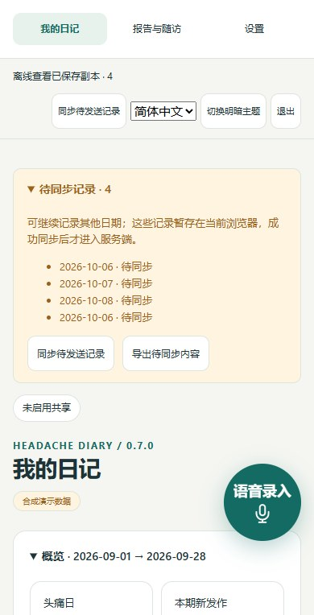](docs/screenshots/offline-zh-070.jpg) | [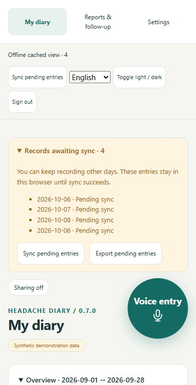](docs/screenshots/offline-en-070.jpg) |

| 西班牙语 · Español | 法语 · Français |
| --- | --- |
| [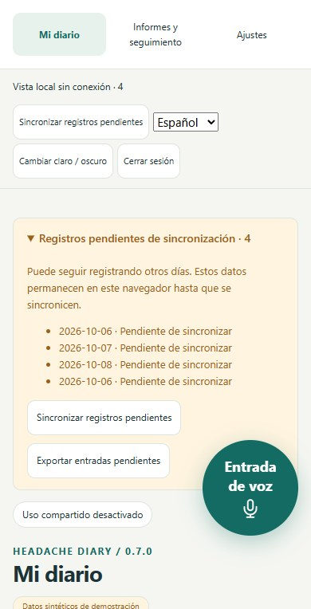](docs/screenshots/offline-es-070.jpg) | [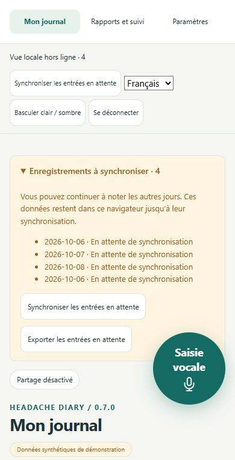](docs/screenshots/offline-fr-070.jpg) |

| 俄语 · Русский | 阿拉伯语 · العربية · RTL |
| --- | --- |
| [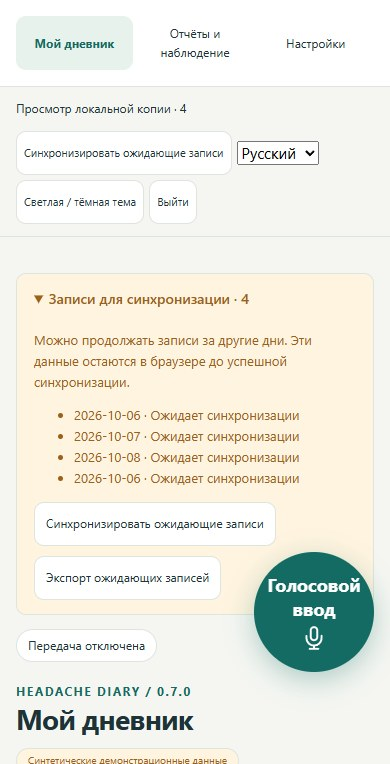](docs/screenshots/offline-ru-070.jpg) | [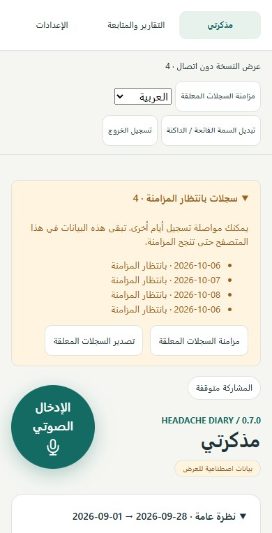](docs/screenshots/offline-ar-070.jpg) |

| 印地语 · हिन्दी | 乌尔都语 · اردو · RTL |
| --- | --- |
| [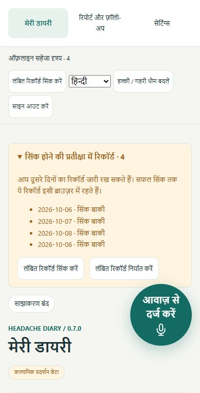](docs/screenshots/offline-hi-070.jpg) | [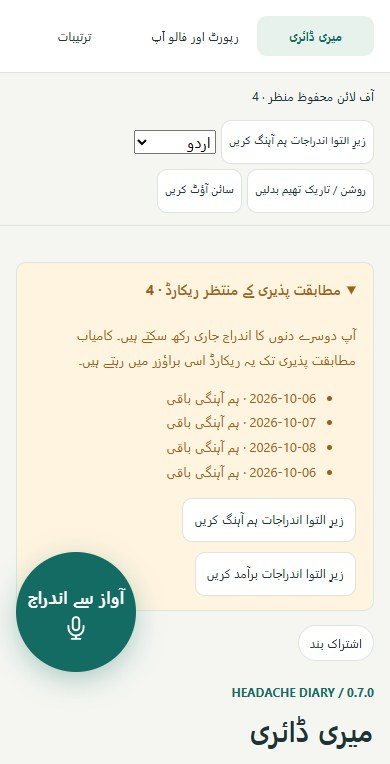](docs/screenshots/offline-ur-070.jpg) |

**0.7.0本机核验：** 169项核心测试、125项合成数据浏览器检查通过；真机、实际部署和患者理解测试仍需独立验证。[证据及复现](docs/VALIDATION.md)。

## 既有0.6.1功能：历史反馈与可追溯摘要

- **逐条查看历史反馈：** 按方案版本、来源和时间回看患者各次反馈，方案调整后仍保留此前内容。
- **方案与反馈进入医生摘要：** 生成摘要时保存治疗方案、调整记录与患者主观变化的快照；既有报告保留生成时内容。建议和反馈不会自动成为实际服药记录。
- **围绕患者日记完善：** 当前医生账号需部署者审核与患者授权；提醒和医院投递仍为本机演示，不启用语音模型或真实临床服务。0.6.1截图保留原模拟工作流作为历史展示。

详见[患者工作流](docs/PATIENT_WORKFLOW.md)、[代表性同类产品比较与发布取舍](docs/PRODUCT_COMPARISON.md)及[各版本验证记录](docs/VALIDATION.md)。比较使用第一方资料，吸收适用的交互和报告优点，不声称全网首创或临床效果优于竞品。本项目采用源码可见许可，非OSI开源。

**0.6.1 核验：** [Ubuntu 与 Windows 远程 CI](https://github.com/Alias1027/Multi-language-Headache-Diary--/actions/runs/39118500923) 各通过137项自动测试及发布／打包检查；此前本机完成101项合成数据浏览器检查。详见[验收与边界](docs/VALIDATION.md)。

### 新功能示例

| 逐条历史反馈 | 包含方案和反馈快照的医生摘要 |
| --- | --- |
| [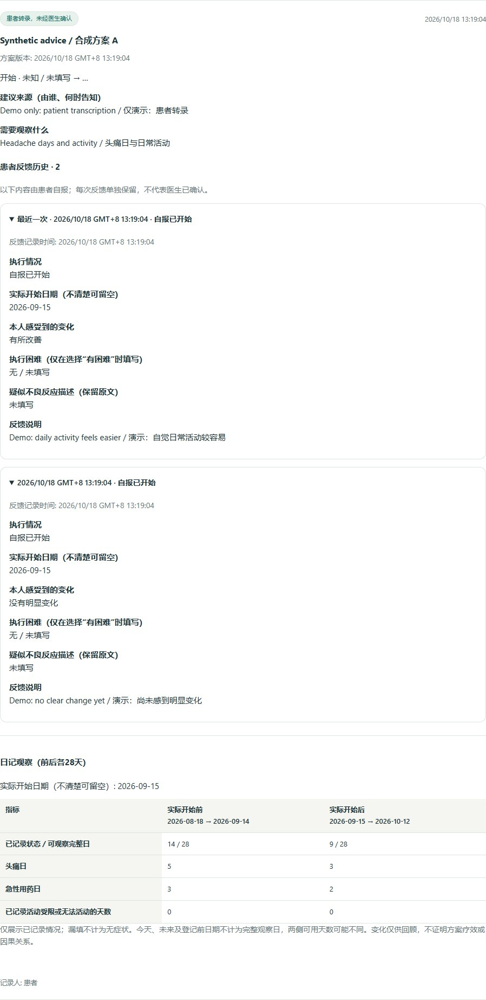](docs/screenshots/feedback-history-zh-061.jpg) | [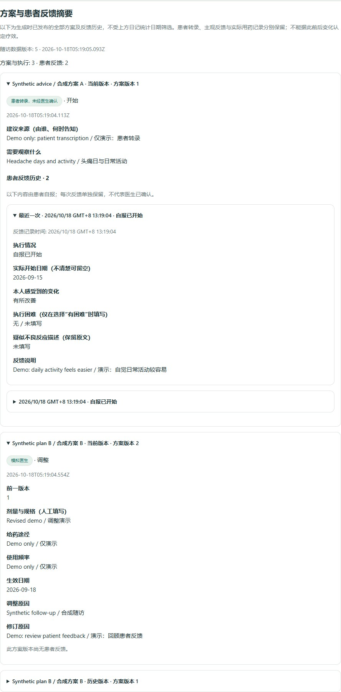](docs/screenshots/clinician-summary-zh-061.jpg) |

以上仅使用合成内容。详见[截图来源](docs/screenshots/README.md)；截图展示界面，不代表临床有效性验证。

## 0.6.0：以患者日记为中心

产品定位为**患者头痛记录系统**。新增患者转录医生已告知方案、注明建议来源、保留修订版本，以及实际开始日期、主观变化、执行困难和疑似不良反应反馈。患者转录与医生账号确认明确区分，两者均不生成实际服药记录。

按患者填写的实际开始日期，回顾前后各28天的日记，同时呈现可观察完整日和缺失情况；不自动判断疗效或因果。语音文字候选支持逐项取舍；涉及建议、计划或既往方案的用药描述保留为原文，待人工区分，未确认的剂量/单位不自动补全。

**仅保留语音识别数据接口、兼容适配与拓展说明，不附带或启用语音模型、Python识别环境或云密钥。** 未接入识别服务时，仍可使用文字整理及人工复核。完整病历、SOAP/DART、自动诊断、电子处方及EHR/HIS写入不在本产品范围。见[患者工作流与边界](docs/PATIENT_WORKFLOW.md)。

## 亮点功能：患者自主提醒

**让提醒配合患者的生活节奏，为持续记录提供支持。** 患者可自行设置每周提醒日、每日时间及时区、消息语言和内容，并在“设置 → 提醒”中随时调整或关闭。

- **个性化且少打扰：** 免打扰时段、暂停日期、当天状态填写完整后跳过，以及每日去重，减少不必要的重复提示。
- **提醒与临床共享分开：** 主动授权后启用，联系方式与提醒历史由当前连接的日记服务加密保存，不进入医生摘要和临床共享数据。
- **可演示、可扩展：** 可测试已保存的计划并查看提醒历史；网页内提示、邮件、短信、PWA、微信和支付宝均有模拟渠道，预留后续真实接入边界。

**当前状态：所有渠道均为本机模拟，不向外发送。** 真实渠道仍需配置、账号绑定及相应授权。支持持续记录是设计目标，尚未验证对患者依从性或临床结局的改善。详见[提醒说明与接口](docs/REMINDERS.md)。

**0.6.0 本地核验：**122项自动测试与71项浏览器检查通过，均使用合成数据。技术通过不代表临床效果或模型识别准确率；详见[验证记录](docs/VALIDATION.md)。

## 主要功能

- **患者自主提醒（亮点）：** 自选时间、语言和内容，支持免打扰、暂停及完成后跳过；当前为本机模拟，详见上方说明。
- **连续患者记录页：** 每日状态、疼痛部位与性质、时间、伴随症状、疑似诱因、急性用药、预防治疗及活动影响；未填写的初始表单不自动生成记录。
- **可复核的摘要：** 分别统计头痛日、发作次数与用药日，明确缺失、未知、跨午夜、记录修订与统计周期的处理规则。
- **八语言界面与报告：** 中文、英语、西班牙语、法语、俄语、阿拉伯语、印地语、乌尔都语。印地语从左至右（LTR），阿拉伯语和乌尔都语从右至左（RTL）；切换界面不改写既有报告与原始备注。
- **需人工确认的语音辅助：** 录音或上传音频，由当前连接的日记服务加密保留原件，将中英文文字整理为待核对字段。提供本机及可选云端适配接口，不附带模型或密钥。
- **模拟随访流程：** 医生评估 → 模拟治疗方案 → 回访，支持确认、修订及患者反馈；建议方案不会自动变为实际用药记录。
- **共享流程实验：** 独立授权、加密数据包、模拟接收端、回执、重复提交去重、重试与撤销后续共享；可导出 JSON 与有限的 FHIR R4 示例。
- **离线草稿：** 首次成功访问后支持浏览器加密草稿及待同步队列。仅适用于可信本机环境，加密不能防护已解锁或被入侵的设备。

## 患者与医生使用流程

| 工作区 | 使用方式 |
| --- | --- |
| **我的日记** | 查看概览，填写当天状态以及相关发作、用药信息，核对后一次保存；未填写的初始表单不计入记录。 |
| **语音录入** | 打开浮窗，录音、上传音频或输入中英文文字；核对候选字段及对应原文后再填入。自动转写需配置识别接口。 |
| **医生建议与随访** | 查看已确认建议、方案版本和逐条反馈；通过关联状态旁的快捷入口前往设置管理授权。 |
| **就诊摘要** | 选择日期和语言，生成日记及建议反馈的时间快照。 |
| **医生独立入口** | 独立账号、部署者批准、患者授权后，先审阅再确认建议。 |
| **设置** | 集中管理医生访问授权，配置自主提醒与模拟测试，管理语言偏好、数据导出及共享／回执演示；默认演示不会向真实医院发送数据。 |

页面顶部的语言选择器用于切换界面。未单独设置报告偏好或本次报告语言时，新报告跟随界面语言；已生成报告和原始自由文本保留各自的语言。

## 当前候选包与既往下载

0.8.2源码/Windows便携包与Android 0.1.0-preview APK分别作为候选附件准备，此处不提供尚不存在的本版公开下载地址。请核对包的版本与SHA-256，步骤见[包类型说明](docs/WINDOWS_PORTABLE.md)和[Android指南](docs/ANDROID_OFFLINE.md)。本版远程检查和下载核验需针对最终提交实际完成后再记录。

### 既往已发布的0.7.0

在[v0.7.0 Release](https://github.com/Alias1027/Multi-language-Headache-Diary--/releases/tag/v0.7.0)的Assets下载：[Windows x64便携包](https://github.com/Alias1027/Multi-language-Headache-Diary--/releases/download/v0.7.0/headache-diary-windows-x64-0.7.0.zip)、[纯源码包](https://github.com/Alias1027/Multi-language-Headache-Diary--/releases/download/v0.7.0/headache-diary-source-0.7.0.zip)、[SHA256SUMS.txt](https://github.com/Alias1027/Multi-language-Headache-Diary--/releases/download/v0.7.0/SHA256SUMS.txt)。它们不同于GitHub自动生成的Source code压缩包。便携包包含Node.js 24和Start/Stop入口；源码使用者需自行配置Node.js 24。

请完整解压到可写的新文件夹。发布包不含既有账号、数据、密钥或音频。升级前备份完整data、导出浏览器待同步记录，保留原网址、data与密钥；不要用干净包覆盖数据。详见[首次使用与升级](docs/WINDOWS_PORTABLE.md)。原v0.6.1发布标签与附件保持不变。

## 欢迎参与体验测试

欢迎感兴趣的用户使用合成案例，反馈难懂、难找、难操作的地方，以及语言和可访问性问题。无需编程经验或个人健康信息，可随时停止；这是软件可用性体验，不是临床试验。详见[双语测试邀请](docs/TEST_INVITATION.md)及[任务和反馈模板](docs/RELEASE_PARTICIPATION.md)。联系 **Junhui Liu M.D. — [junhuiliu1025@gmail.com](mailto:junhuiliu1025@gmail.com)**，或[本仓库 Issues](https://github.com/Alias1027/Multi-language-Headache-Diary--/issues)。机构及商业评估仍须事先书面授权，邀请不构成许可豁免。

## 从源码启动

安装 **Node.js 24.x**。默认演示无需安装 npm 运行依赖、独立数据库、模型或 API 密钥。

```sh
node --version
npm test
npm run check:release
npm start
```

打开 **http://127.0.0.1:8765**，选择 **体验合成病例**。每次选择此入口都会建立新的独立合成账号。按 Ctrl+C 停止服务，记录默认保留在 `../data/`。服务仅监听本机回环地址；`.env.example` 是配置说明，不会自动加载。

另行准备的 Windows 便携目录提供 `Start.cmd`、`Stop.cmd`、`Test.cmd` 及运行环境。GitHub 源码本身不依赖这些启动器。详见[中文使用说明](docs/USER_GUIDE.zh.md)。

## 五分钟演示

1. 打开合成病例的“我的日记”。2026 年 9 月 1–28 日固定示例：**记录 23/28 天、头痛 8 天、发作 7 次、急性用药 5 天，覆盖率 82.1%**。
2. 切换语言，查看印地语 LTR、乌尔都语 RTL；结构化含义和统计数值保持不变。
3. 在“就诊摘要”选择周期、生成摘要，也可单独选择报告语言。
4. 进入独立医生工作台，查看评估、方案和回访，再返回患者视图。
5. 在语音浮窗输入中英文文字，核对候选及原文依据后填入表单。自动转写需另行配置适配器。

## 保留的0.6.1八语言界面示例

以下八张截图均于 **2026-10-18** 从 **0.6.1** 的独立合成病例中实际截取，展示相同的患者概览、统计周期（2026-09-01 至 2026-09-28）和浏览器视口。点击图片可查看原图。

各语言都显示 **8 个头痛日、7 次发作、5 个急性用药日、23/28 天记录及 82.1% 覆盖率**。LTR 表示从左至右，RTL 表示从右至左；阿拉伯语和乌尔都语使用 RTL，印地语使用 LTR。

| 中文 · 简体中文 · `zh` · LTR | 英语 · English · `en` · LTR |
| --- | --- |
| [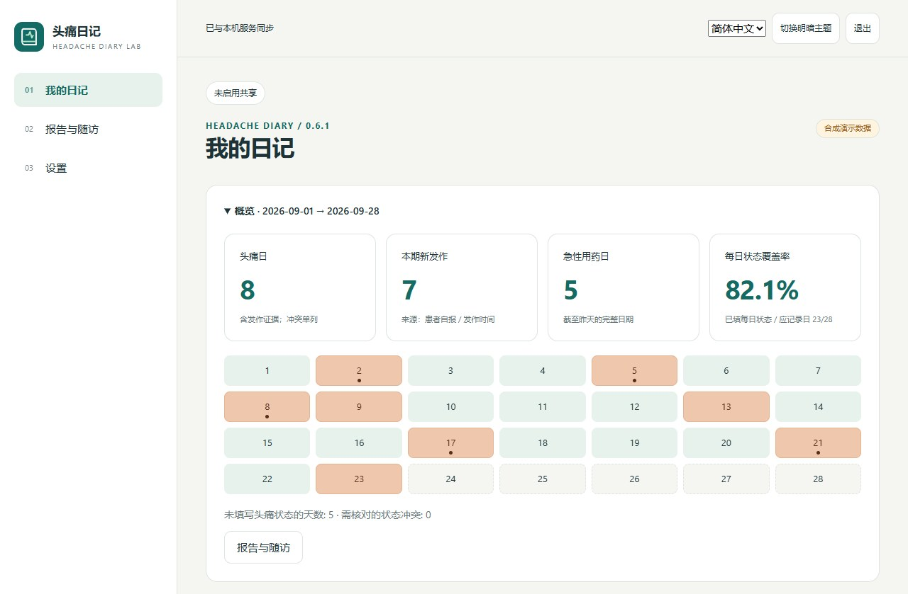](docs/screenshots/patient-zh-061.jpg) | [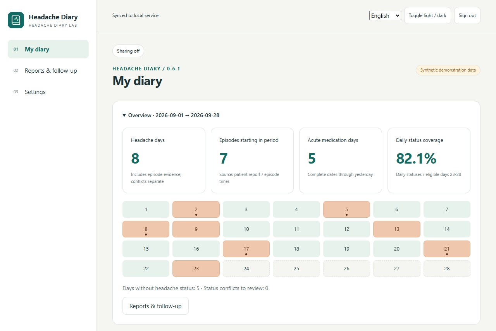](docs/screenshots/patient-en-061.jpg) |

| 西班牙语 · Español · `es` · LTR | 法语 · Français · `fr` · LTR |
| --- | --- |
| [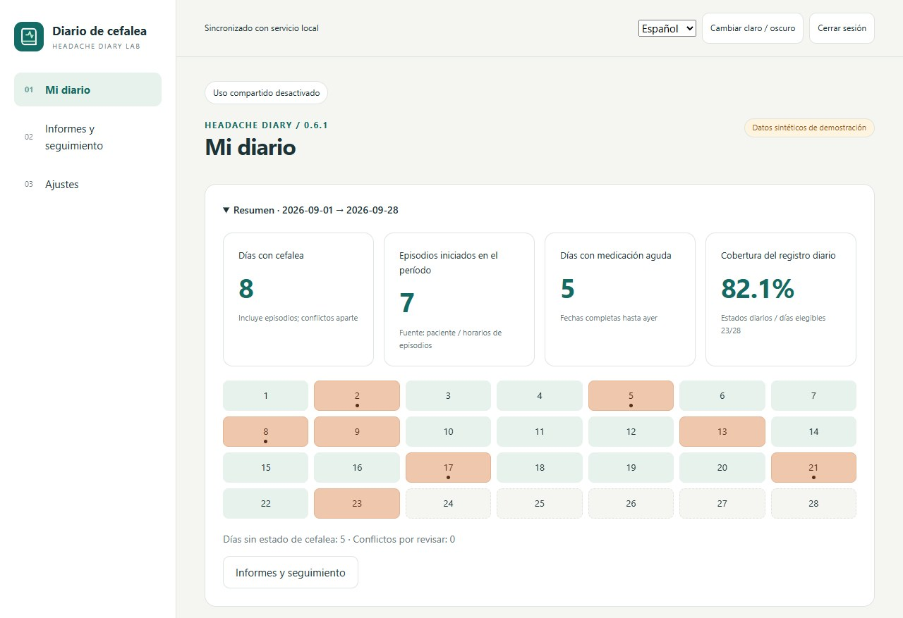](docs/screenshots/patient-es-061.jpg) | [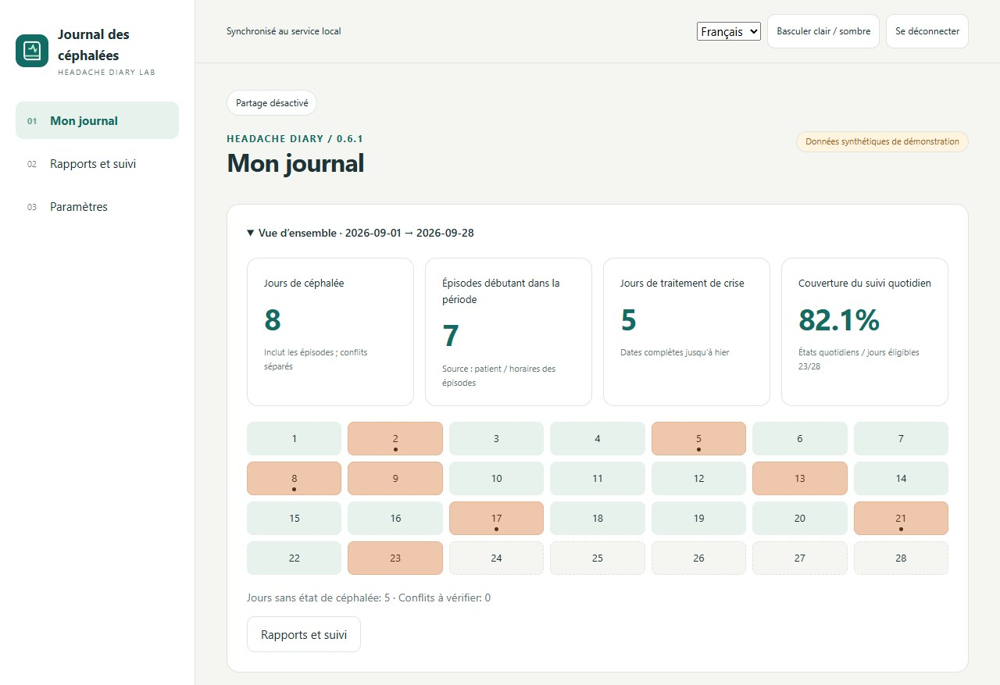](docs/screenshots/patient-fr-061.jpg) |

| 俄语 · Русский · `ru` · LTR | 阿拉伯语 · العربية · `ar` · RTL |
| --- | --- |
| [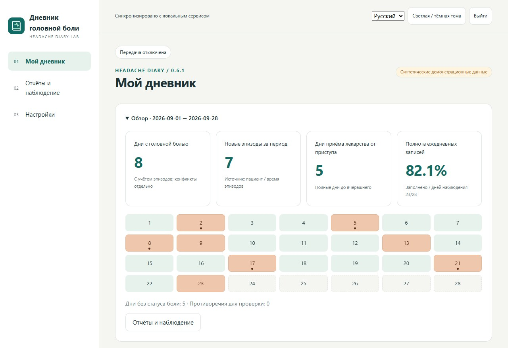](docs/screenshots/patient-ru-061.jpg) | [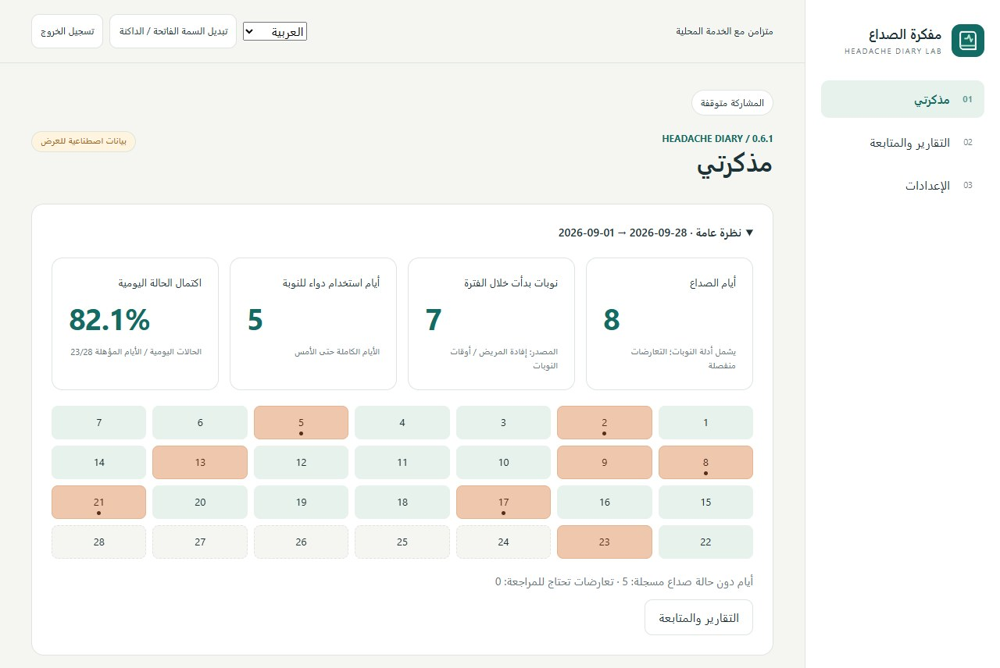](docs/screenshots/patient-ar-061.jpg) |

| 印地语 · हिन्दी · `hi` · LTR | 乌尔都语 · اردو · `ur` · RTL |
| --- | --- |
| [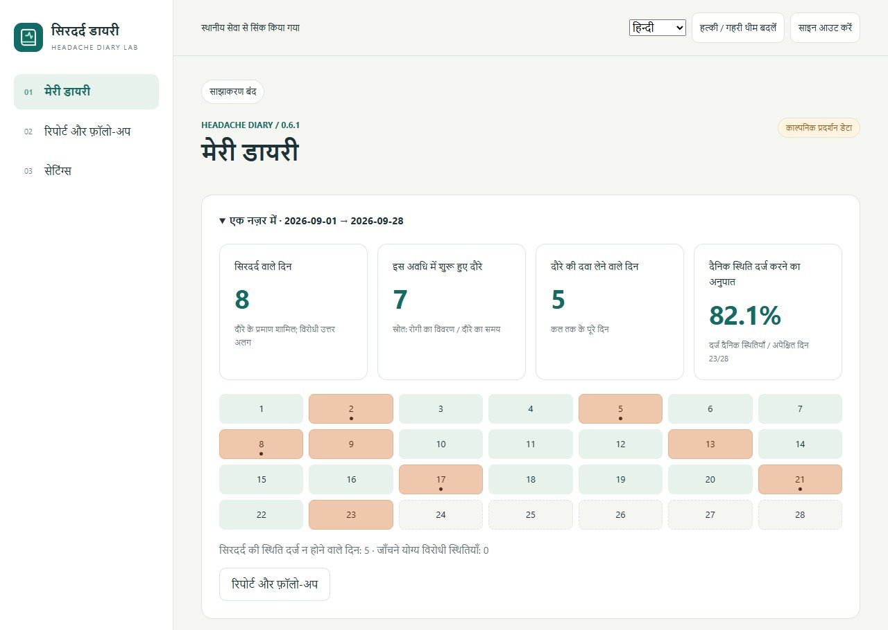](docs/screenshots/patient-hi-061.jpg) | [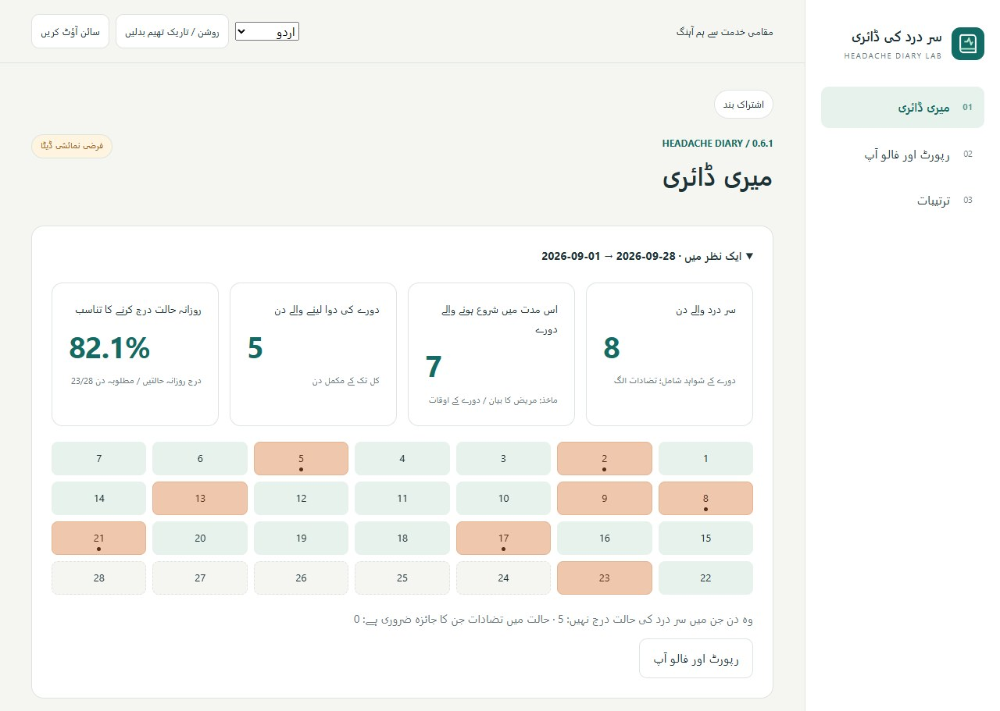](docs/screenshots/patient-ur-061.jpg) |

**支持范围：** 八种语言均有界面与报告选项；语音识别及结构化提取目前仅提供中英文接口，需自行配置识别服务并人工核对。截图是界面展示，不代表已完成母语临床审校或患者可用性验证。参见[截图来源与复现方法](docs/screenshots/README.md)和[多语言说明](docs/LOCALIZATION.md)。

## 检查与源码打包

`npm test` 验证合成临床案例、HTTP、权限、语言、模型接口、离线与打包边界；`npm run check:release` 检查当前文档版本、相对链接、源码边界与离线资源。[v0.6.1 标签工作流](https://github.com/Alias1027/Multi-language-Headache-Diary--/actions/runs/39118500923) 已在 Ubuntu 和 Windows 通过。后续提交状态请查看 [Actions](https://github.com/Alias1027/Multi-language-Headache-Diary--/actions)；此处链接的发布结果明确对应 c1644cd。

使用 PowerShell 打包（Linux 需 PowerShell 7）：

```powershell
pwsh -File scripts/package.ps1 -Destination ../headache-release
```

目标目录必须为空且在源码目录之外。输入目录混入私密或运行数据时会拒绝打包；运行后请将 `data/` 存放在公开源码目录之外，或使用干净检出打包。`SHA256SUMS.txt` 包含源码与 ZIP 校验值；执行 `node scripts/verify-manifest.mjs ../headache-release` 可检查缺失、篡改或多余文件。

[可复制的GitHub短简介与主题标签](docs/GITHUB_ABOUT.md)

| 文档 | 内容 |
| --- | --- |
| [项目工作报告](docs/PROJECT_REPORT.md) / [完成情况](docs/IMPLEMENTATION_STATUS.md) | 临床设计、当前能力与后续任务 |
| [数据字典](docs/DATA_DICTIONARY.md) / [架构](docs/ARCHITECTURE.md) | 统计定义、来源、存储与接口边界 |
| [语音功能](docs/VOICE_INTEGRATION.md) / [模型接口](docs/MODEL_INTEGRATION.md) | 接口、授权及人工核对 |
| [多语言说明](docs/LOCALIZATION.md) | 八语言目录、排版方向及待审校事项 |
| [验收记录](docs/VALIDATION.md) / [发布检查](docs/RELEASE_CHECKLIST.md) | 验证证据与发布门槛 |
| [贡献指南](CONTRIBUTING.md) / [安全说明](SECURITY.md) / [依赖说明](NOTICE.md) | 协作、安全反馈与许可 |

## 当前边界与下一步

独立临床规则复核、母语审校、患者理解测试、可访问性及安全评审仍待完成。中英文语音与大模型接口目前采用模拟响应验证，未进行真实供应商的准确率基准测试。印地语和乌尔都语界面不代表支持对应语音或 Hinglish。项目不声称诊断准确性、治疗获益或全球人口覆盖率。

真实邮件、医院部署与微信／支付宝／抖音小程序上线需另行实施验收。部署者批准不等于医师资质认证，建议记录不是电子处方。[研究计划](docs/RESEARCH_PLAN.md)列出可测量的后续验证工作。

欢迎通过合成案例贡献临床边界测试、母语审校与可访问性反馈。请准确说明证据，区分已实现功能、未来计划与经过验证的效果。

## English overview

**Headache Diary Lab** is an eight-language, local-first research prototype for recording headache burden and preparing clinician-readable follow-up summaries. A single patient page combines daily status, headache episodes, medication use and reviewed voice-assisted input. Summaries distinguish headache days, attacks, medication days and missing records. A separately authenticated, patient-authorized clinician workspace supports review, advice updates and follow-up.

**Get started:** install Node.js 24.x, run `npm test`, `npm run check:release` and `npm start` from the source directory, then open **http://127.0.0.1:8765** and choose **Try synthetic case**. The default demo requires no API key, model download or npm runtime dependencies. Use the language selector to switch among Chinese, English, Spanish, French, Russian, Arabic, Hindi and Urdu; the eight screenshots above show the same synthetic overview.

**Research scope:** interface/report localization covers eight languages. Speech and structured extraction adapters currently cover Chinese and English only, with a configured service and manual review. Email/hospital receivers are simulated, mini-program folders are scaffolds, and clinical outcomes, model accuracy and native clinical translations have not been independently validated.

**License:** source-available for independent personal noncommercial learning and experiments. All institutional and commercial use requires prior written authorization from **Junhui Liu M.D.** Contact [junhuiliu1025@gmail.com](mailto:junhuiliu1025@gmail.com) or the [official project repository](https://github.com/Alias1027/Multi-language-Headache-Diary--). This is not an OSI-approved open-source license.

Read the [full English README](README.md) for features, the patient/clinician workflow, startup, packaging, documentation links and limitations.

## 许可与授权

权利人：**Junhui Liu M.D.**。[许可](LICENSE)允许独立个人的非商业学习与实验；**全部机构及商业用途须事先取得书面授权**，包括非营利机构内部评估。可通过 [junhuiliu1025@gmail.com](mailto:junhuiliu1025@gmail.com) 或[官方 GitHub 仓库](https://github.com/Alias1027/Multi-language-Headache-Diary--)联系。本项目为源码可见，并非OSI认可的开源许可；第三方许可和旧版已授予权利不受追溯影响。见[授权政策](docs/LICENSING.md)。


**历史0.8.1核验：** 既往本机工程结果保留在[验收记录](docs/VALIDATION.md)，不等同于最终0.8.2验证。本版证据及预发布后待测试事项见[0.8.2发布说明](docs/RELEASE_NOTES_0.8.2.md)。
