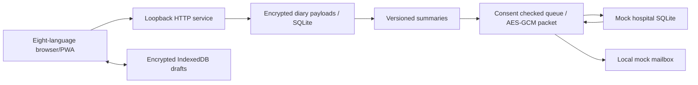

# Local architecture, API and security boundary — 0.6.1

## Display-only first forms

public/entry-templates.mjs marks automatic first forms with browser-draft-only _template metadata. entriesToSave removes only untouched automatic templates and strips this metadata before submission. Explicit zero/unknown, partial values, voice provenance and existing revisions prevent omission. Native required attributes and clinical assessment checks skip only untouched templates; server requirements remain unchanged. Manual added rows keep the original validation behavior. Care editor disclosure was removed without changing role authorization or unsaved-change guards.

## Required assessments

`public/episode-assessment.mjs` owns shared pure assessment validation, eight-language assessment labels and UI rendering. Both form variants call its DOM feedback helpers; `domain.validate` enforces the same answer rules for both write APIs. Browser drafts keep unanswered values. Record extensions are additive; no existing encrypted payload is rewritten during deployment.

The server is a Node24 ES-module application with no external runtime packages. It binds **127.0.0.1 only** and checks Host and Origin. There is no public deployment mode. UI modules, translations, fonts/system fallback and QR code generation run without remote CDN requests. The pure statistics module is shared between browser overview and server reports, keeping one rule implementation.

## Storage and access

- Accounts: normalized email HMAC lookup, scrypt password hash with random salt, encrypted email/profile. No platform identity or real email ownership validation.
- Session: random bearer in HttpOnly SameSite=Strict cookie, 12-hour expiry; database stores HMAC digest. Per-session CSRF token required on authenticated mutations. HTTPS/Secure-cookie mode is not present because this is a loopback-only build.
- Browser: AES-GCM with a non-extractable CryptoKey persisted in IndexedDB; drafts, pending entries and last snapshot encrypted with entry-name authenticated data. The app's origin can access the key, so this does **not** defend against malicious same-origin script, OS account compromise, or a person using an unlocked browser profile.
- Server: AES-256-GCM with fresh 96-bit IV per encryption, authenticated context identifying account and payload purpose. Clinical payload, email, snapshots and outgoing jobs are encrypted. Some technical metadata (UUIDs, revision numbers, audit event names, timestamps) and password hashes are not encrypted. SQLite is not whole-file SQLCipher.
- Keys: random local diary and recipient keys in `data/local-keys.json`, never in source. They are separate from database files but colocated on this computer. No KMS, remote HSM, automatic rotation or recovery service. Back up keys with databases under controlled access. Administrator/OS-level compromise is out of scope.
- Access: every data/API request is tied to the authenticated local patient account. The paired synthetic clinician has separate server-enforced role and assigned-patient checks (see Care workspace below). This is not a production hospital identity service.
- Static headers: CSP disallows third-party resources, inline script, frames and objects; no CORS; escaped UI values. JSON bodies capped at256KiB; authenticated voice uploads capped at10MiB, login/register/demo routes locally rate limited. Production abuse controls and load testing remain pending.

## Sharing

Consent covers one fixed **mock-clinic**. Patient mapping is deterministic local HMAC; no actual medical identity is verified. Queue snapshot includes a generated report and, if permitted, period records. Cross-boundary episodes are included whole when overlapping the selected period, so start/end may lie outside its dates. Summary scope still contains preventive names/regimens/notes in its treatment timeline; the scope label explicitly says treatment timeline.

Packet encryption occurs at queue creation. Receiver key and transfer ID context authenticate the packet; no decrypting key is transmitted. Queue checks active grant ID, scope, institution and expiry immediately before every attempt. A replacement grant does not revive prior queued work. Revocation blocks queued/retry/manual-attention tasks at delivery; delivered receipts remain.

Receiver stores encrypted content in a distinct SQLite file and acknowledges only after durable insertion. Unique transfer ID prevents duplication after a lost ACK. It checks patient/institution/transfer/revision matches. Since both modules execute in one process, this demonstrates **application-layer packet protection**, not real network TLS or isolated servers.

Automatic retry delay is `min(1h, 2^attempt × 30s)`, up to five attempts then needs_attention. UI manual retry can retry that state. Record edits supersede undelivered old snapshots and issue correction snapshots for previously shared periods under active consent. Report versions and previous receiver revisions remain traceable.

Schedule checks every minute only while running; latest complete week/month, no historical catch-up sweep. Deduplication key includes period, grant and source revision. Email notification is an independent **local mailbox entry** containing report ID, never an outgoing SMTP attachment. There are no automatic external communications.

## HTTP contract

All API responses JSON; GET responses no-store. Authenticated POSTs use cookie plus `X-CSRF-Token` returned by `/api/state`.

| Endpoint | Behavior |
|---|---|
| GET /api/health | version/readiness, no clinical data |
| POST /api/register, /api/login | email/password; new local session |
| POST /api/demo | new synthetic account and session |
| GET /api/state | own profile, vault, CSRF, recent audit |
| GET /api/mailbox | own mock code and notifications |
| POST /api/verify, /api/resend-code | local verification simulation; not proof of email ownership |
| POST /api/records | `{kind,record,operationId}`; daily/episode/medication/preventive create or revise |
| POST /api/settings | languages, locked timezone/enrolment, reminder preference |
| POST /api/report | `{from,to,language}`; stored immutable summary |
| POST /api/consent | active, scope, frequency, expiry; only fixed mock clinic |
| POST /api/share | queue `{from,to,language}` |
| POST /api/process | process/retry; optional fault offline/lost_ack |
| POST /api/schedule | run latest completed scheduled period |
| GET /api/receipts | only current account's mock-clinic receipt metadata |
| GET /api/packet?id=... | authenticated ciphertext export for own transfer |
| GET /api/export[?format=fhir] | plaintext own data or limited FHIR R4 example |
| POST /api/logout | revoke session |

Errors include invalid_record, revision_conflict/date_conflict (409), login_required (401), invalid_origin/invalid_host/invalid_csrf (403), consent_required and verify_first. No remote API token interface exists for native mini-programs in this version.

## Voice extension

See [VOICE_INTEGRATION.md](VOICE_INTEGRATION.md) for API and storage details. The browser records with MediaRecorder after microphone permission; CSP permits same-origin/blob audio. Separate encrypted SQLite voice rows avoid duplicating audio into diary revisions and hospital transfer packets. A configurable loopback HTTP adapter receives original audio when requested; optional cloud adapters require explicit configuration and per-request consent. Default ASR is disabled. Parser suggestions remain separate from official records until user confirmation.

## Before external deployment

Implement TLS and explicit HTTPS origins, Secure cookies, account recovery and real email provider controls, institution roles, actual patient matching/confirmation, clinician access/audit, credential/key management, backup/restore exercises, data retention/withdrawal, platform privacy rules, clinically reviewed terminology, independent security review and load/concurrency assessment. Do not simply bind this prototype to 0.0.0.0 or tunnel it onto the internet.

Technical references: [Node24 SQLite](https://nodejs.org/docs/latest-v24.x/api/sqlite.html), [Node24 crypto](https://nodejs.org/docs/latest-v24.x/api/crypto.html), [FHIR R4 QuestionnaireResponse](https://hl7.org/fhir/R4/questionnaireresponse.html). These explain APIs, not certify this application.

## Care workspace

server/care.mjs adds care_records(patient_id, body). The body uses AES-256-GCM with the existing diary key and a patient-specific AAD context ending in ':care'. It contains a monotonically increasing revision, assessment/follow-up/plan/feedback collections, immutable history snapshots and actor-scoped operation IDs. Its updates do not alter diary revision or medication statistics. The mock-hospital sharing packet is unchanged and does not automatically include new care records.

- GET /api/care: current assigned patient only; patient responses omit draft assessments/plans/follow-ups and clinician history. Confirmed records are visible to that patient.
- POST /api/care/save: kind, record, global revision, operationId. Clinicians write assessments/followups/plans; patients append feedback on confirmed plans. Conflicts return 409. Replayed actor operation IDs do not duplicate records.
- POST /api/demo/role: patient or clinician, synthetic accounts only. Creates/uses a paired doctor profile and replaces the authenticated session cookie. Server-side reciprocal assignment checks select the patient; request-supplied patient IDs never select a target.
- Clinician sessions can access state, care, report and logout only. They cannot mutate patient diary entries, access voice recordings or grant sharing consent.
- Existing encrypted users/vaults need no destructive migration. A new empty table is added lazily at app startup. Legacy accounts default to patient role.
- Care history is capped at 1,000 writes per synthetic account; each collection is capped at 500 records. Original clinician snapshots remain in encrypted backups. Patient exports include only patient-visible care records.

This local synthetic identity switch intentionally demonstrates both roles on one trusted computer. It does not establish real clinician credentials, production identity management, legal prescription validity, clinical verification or external interoperability. Browser role changes retain the same synthetic patient's diary drafts; logging out clears browser data as before.

## Unified diary submission

POST /api/diary/batch accepts {date, operationId, records: [{kind, record}]}. Exactly one day record and at most 30 event/regimen records; patient role and CSRF required. Per-record revisions and voice provenance are checked before persisting an isolated vault. Event dates must overlap the selected civil date (episode end is exclusive); doses must occur on that date. Explicit negative day status cannot conflict with saved or submitted episodes/doses.

One SQLite transaction writes the final encrypted vault and final revision snapshot. Individual record revisions and the vault revision advance using existing rules; no intermediate batch snapshots are stored. diaryBatches holds operation-id/digest pairs in the encrypted vault for exact-payload retries, and is excluded from exports. Reports/queued corrections are derived from the completed batch. The browser encrypts the outbox before sending; duplicate replies may be retried with the same payload. Raw audio/note saving remains independent of diary submission.

The page uses public/diary-ui.mjs; standalone historical/legacy forms remain for compatibility. New unified drafts are keyed by account id; old per-form drafts are preserved. Pending unified drafts freeze until sync. Clinical rule version remains 0.1.0.

## Required episode quality

Shared validate() rejects missing/empty episode quality with invalid_episode_quality. Both /api/records and /api/diary/batch use this validator. Batch validation still completes before the isolated vault is persisted, so a missing quality on any episode leaves every record unchanged. The unified and legacy forms show required legends and field-local errors. Existing exact operation replays remain idempotent; historical data is not migrated or populated automatically.

## Optional model boundary

server/ai-providers.mjs holds provider configuration and credentials outside public assets. /api/voice/extract reads one authenticated note revision, sends only its text/language and a fixed prompt, validates a bounded candidate contract, rechecks the revision and stores review-pending provenance encrypted with the note. It never writes clinical events. Default processing is local/off. See MODEL_INTEGRATION.md for explicit cloud enablement, per-request consent and protocol limits. Report options are centralized in public/report-options.mjs; existing snapshots remain immutable.

## 0.5.2 提醒与语音入口更新

设置新增患者主动启用的提醒计划（星期、时间及时区、语言、内容、联系方式、渠道、免打扰、暂停和当天填写完整后跳过）。本版只生成本机模拟记录，不发送外部消息。提醒联系方式与历史加密保存在账号个人配置中，不进入医生视图、临床报告和共享载荷。原有临床记录保持不变；没有主动保存新提醒设置的账号不会启动后台提醒。语音悬浮入口已放大，保留八语言与 RTL 适配。详见 [提醒接口及使用边界](REMINDERS.md)。

## 0.6.0 patient care extension

`POST /api/care/save` adds patient-only `patientPlans` and structured self-reported feedback. `GET /api/care` preserves role filtering and source markers; `GET /api/export` includes patient-visible care. `public/care-observation.mjs` reuses existing diary summaries and never mutates records. `public/voice-review.mjs` provides field selection and a conservative medication-advice guard shared by rule and model pipelines. These are patient diary extensions, not EHR writeback or automatic orders.

## Published care snapshots (0.6.1)

`POST /api/report` constructs `careSummary` through `server/care-report.mjs` before persisting the report. The builder selects published scalar fields only and never embeds assessment.report or private drafts. `public/care-report-ui.mjs` renders this immutable appendix; the display-only feedback renderer is shared with the care workspace. Print temporarily opens all nested report details and restores their previous state. The download uses the exact saved report object. Existing manual/scheduled sharing still calls the diary-only report builder, preserving consent scope.
