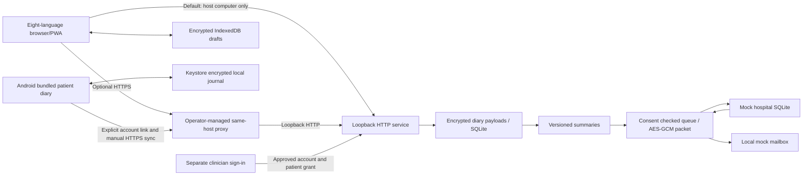

# Architecture, API and deployment boundary — 0.8.2

> 0.8.2：医生入口与授权流程以 [CLINICIAN_ACCESS.md](CLINICIAN_ACCESS.md) 为准。旧版“模拟角色切换”已移除；下文涉及 v0.7.0 的发布/验证记录属于历史证据。当前新增范围需独立验证，未复用旧 CI 结果。

## Display-only first forms

public/entry-templates.mjs marks automatic first forms with browser-draft-only _template metadata. entriesToSave removes only untouched automatic templates and strips this metadata before submission. Explicit zero/unknown, partial values, voice provenance and existing revisions prevent omission. Native required attributes and clinical assessment checks skip only untouched templates; server requirements remain unchanged. Manual added rows keep the original validation behavior. Care editor disclosure was removed without changing role authorization or unsaved-change guards.

## Required assessments

`public/episode-assessment.mjs` owns shared pure assessment validation, eight-language assessment labels and UI rendering. Both form variants call its DOM feedback helpers; `domain.validate` enforces the same answer rules for both write APIs. Browser drafts keep unanswered values. Record extensions are additive; no existing encrypted payload is rewritten during deployment.

The server is a Node24 ES-module application with no external runtime packages. It binds **127.0.0.1 only** and checks Host and Origin. Default mode is local; an explicit exact-origin HTTPS reverse-proxy mode is provided for operator-controlled synthetic pilots (see [mobile deployment](MOBILE_DEPLOYMENT.md)). UI modules, translations, fonts/system fallback and QR code generation run without remote CDN requests. The pure statistics module is shared between browser overview and server reports, keeping one rule implementation.

## Storage and access

- Accounts: normalized email HMAC lookup, scrypt password hash with random salt, encrypted email/profile. No platform identity or real email ownership validation.
- Session: random bearer in HttpOnly SameSite=Strict cookie, 12-hour expiry; database stores HMAC digest. Per-session CSRF token required on authenticated mutations. The opt-in HTTPS proxy mode adds Secure cookies and validates the trusted loopback proxy, exact Host/Origin and forwarding headers.
- Browser: AES-GCM with a non-extractable CryptoKey persisted in IndexedDB; drafts, pending entries and last snapshot encrypted with entry-name authenticated data. The app's origin can access the key, so this does **not** defend against malicious same-origin script, OS account compromise, or a person using an unlocked browser profile.
- Offline access: a previously initialized patient browser can use its cached diary while the server is unreachable or the session has expired. There is no separate offline PIN or identity verification; same-account server login is required to resume authenticated synchronization. Changing browser origin does not migrate local records. Storage persistence requests and queue exports are recovery aids, not a guarantee against device loss or cleared site data.
- Server: AES-256-GCM with fresh 96-bit IV per encryption, authenticated context identifying account and payload purpose. Clinical payload, email, snapshots and outgoing jobs are encrypted. Some technical metadata (UUIDs, revision numbers, audit event names, timestamps) and password hashes are not encrypted. SQLite is not whole-file SQLCipher.
- Keys: random local diary and recipient keys in `data/local-keys.json`, never in source. They are separate from database files but colocated on this computer. No KMS, remote HSM, automatic rotation or recovery service. Back up keys with databases under controlled access. Administrator/OS-level compromise is out of scope.
- Access: patient requests are tied to the authenticated patient account. Clinician requests use a separate account/session and require operator approval plus the selected patient's active grant (see Care workspace below). The old paired-role shortcut is denied. Approval is not professional credential verification or a production hospital identity service.
- Static headers: CSP disallows third-party resources, inline script, frames and objects; no CORS; escaped UI values. JSON bodies capped at256KiB; authenticated voice uploads capped at10MiB, login/register/demo routes locally rate limited. Production abuse controls and load testing remain pending.

## Sharing

Consent covers one fixed **mock-clinic**. Patient mapping is deterministic local HMAC; no actual medical identity is verified. Queue snapshot includes a generated report and, if permitted, period records. Cross-boundary episodes are included whole when overlapping the selected period, so start/end may lie outside its dates. Summary scope still contains preventive names/regimens/notes in its treatment timeline; the scope label explicitly says treatment timeline.

Packet encryption occurs at queue creation. Receiver key and transfer ID context authenticate the packet; no decrypting key is transmitted. Queue checks active grant ID, scope, institution and expiry immediately before every attempt. A replacement grant does not revive prior queued work. Revocation blocks queued/retry/manual-attention tasks at delivery; delivered receipts remain.

Receiver stores encrypted content in a distinct SQLite file and acknowledges only after durable insertion. Unique transfer ID prevents duplication after a lost ACK. It checks patient/institution/transfer/revision matches. Since both modules execute in one process, this demonstrates **application-layer packet protection**, not real network TLS or isolated servers.

Automatic retry delay is `min(1h, 2^attempt × 30s)`, up to five attempts then needs_attention. UI manual retry can retry that state. Record edits supersede undelivered old snapshots and issue correction snapshots for previously shared periods under active consent. Report versions and previous receiver revisions remain traceable.

Schedule checks every minute only while running; latest complete week/month, no historical catch-up sweep. Deduplication key includes period, grant and source revision. Email notification is an independent **local mailbox entry** containing report ID, never an outgoing SMTP attachment. There are no automatic external communications.

## HTTP contract

All API responses JSON; GET responses no-store. Authenticated POSTs use cookie plus `X-CSRF-Token` returned by `/api/state`.

| Endpoint | Behavior |
|---|---|
| GET /api/health | version/deployment mode, no clinical data; not a full readiness audit |
| POST /api/register, /api/login | email/password; new local session |
| POST /api/demo | new synthetic account and session |
| GET /api/state | own profile, vault, CSRF, recent audit |
| GET /api/mailbox | own mock code and notifications |
| POST /api/verify, /api/resend-code | local verification simulation; not proof of email ownership |
| POST /api/records | `{kind,record,operationId}`; daily/episode/medication/preventive create or revise |
| POST /api/settings | languages, locked timezone/enrolment, reminder preference |
| POST /api/report | `{from,to,language}`; stored immutable summary |
| POST /api/consent | active, scope, frequency, expiry; only fixed mock clinic |
| POST /api/share | queue `{from,to,language}` |
| POST /api/process | process/retry; optional fault offline/lost_ack |
| POST /api/schedule | run latest completed scheduled period |
| GET /api/receipts | only current account's mock-clinic receipt metadata |
| GET /api/packet?id=... | authenticated ciphertext export for own transfer |
| GET /api/export[?format=fhir] | plaintext own data or limited FHIR R4 example |
| POST /api/logout | revoke session |

Errors include invalid_record, revision_conflict/date_conflict (409), login_required (401), invalid_origin/invalid_host/invalid_csrf (403), consent_required and verify_first. No remote API token interface exists for native mini-programs in this version.

## Voice extension

See [VOICE_INTEGRATION.md](VOICE_INTEGRATION.md) for API and storage details. The browser records with MediaRecorder after microphone permission; CSP permits same-origin/blob audio. Separate encrypted SQLite voice rows avoid duplicating audio into diary revisions and hospital transfer packets. A configurable loopback HTTP adapter receives original audio when requested; optional cloud adapters require explicit configuration and per-request consent. Default ASR is disabled. Parser suggestions remain separate from official records until user confirmation.

## Before an operator-managed deployment

The exact-origin HTTPS proxy checks and Secure cookies are implemented, but the proxy, DNS, certificates, renewal, external reachability and phone acceptance must still be deployed and verified by an operator. The example assumes one trusted same-machine proxy and rejects arbitrary forwarding chains; it is not a CDN/tunnel configuration. Open registration and simulated email verification remain. Account recovery, participant access controls, credential/key management, backup/restore exercises, data retention/withdrawal, security review and load/concurrency assessment remain external work. Version 0.8.0 adds operator-approved accounts and patient authorization; professional credential verification and full hospital workflows remain outside this scope. Do not simply bind the prototype to 0.0.0.0 or expose it through an unreviewed tunnel.

Technical references: [Node24 SQLite](https://nodejs.org/docs/latest-v24.x/api/sqlite.html), [Node24 crypto](https://nodejs.org/docs/latest-v24.x/api/crypto.html), [FHIR R4 QuestionnaireResponse](https://hl7.org/fhir/R4/questionnaireresponse.html). These explain APIs, not certify this application.

## Current care workspace (introduced in 0.8.0)

The separate `clinician.html` entry uses `hd_clinician` sessions and `/api/clinician/*` routes. Patient cookies cannot authenticate clinician routes, and clinician identities are rejected by patient routes. Registration creates a pending account; a filesystem-authorized operator approves or suspends it with `scripts/clinician-account.mjs`. Approval is not professional credential verification. The former `/api/demo/role` route is denied.

`care_grants` stores encrypted, expiring patient permissions. A clinician connection code identifies an approved account but grants no access by itself. Every patient-specific clinician request checks account approval and active patient permission. Patient-selected labels are disclosed only to the authorized clinician. Audio, contacts, reminders, transfer jobs and audit exports are excluded by a clinical-vault allowlist.

`care_records` retains existing encrypted care versions, feedback and history. Doctor drafts are visible/editable only by their author. Confirmed advice is amended rather than overwritten; actual patient medications are never fabricated. `care_reviews` records the reviewer, grant ID, dated report ID, diary revision and patient feedback/advice fingerprint. Confirmed writes require a current review; revoked/reissued grants and patient changes invalidate earlier review evidence. Confirmed records retain review and summary references. Summary snapshots remain immutable and omit drafts.

All three tables use the existing encryption key with distinct AAD contexts; migration adds tables without rewriting legacy users, diary vaults or history. Old simulated clinician profiles remain retained but inactive until operator approval and a separate password reset. Patient authorization is never migrated implicitly. The online-only clinician app does not use the patient IndexedDB cache; the service worker bypasses clinician entry/module and all API routes.

This is a patient-diary research workflow, not hospital identity infrastructure or electronic prescribing. Public deployment, credential verification, operational recovery, clinical validation and real-device testing remain separate requirements. See [the bilingual setup guide](CLINICIAN_ACCESS.md).

## Unified diary submission

POST /api/diary/batch accepts {date, operationId, records: [{kind, record}]}. Exactly one day record and at most 30 event/regimen records; patient role and CSRF required. Per-record revisions and voice provenance are checked before persisting an isolated vault. Event dates must overlap the selected civil date (episode end is exclusive); doses must occur on that date. Explicit negative day status cannot conflict with saved or submitted episodes/doses.

One SQLite transaction writes the final encrypted vault and final revision snapshot. Individual record revisions and the vault revision advance using existing rules; no intermediate batch snapshots are stored. diaryBatches holds operation-id/digest pairs in the encrypted vault for exact-payload retries, and is excluded from exports. Reports/queued corrections are derived from the completed batch. The browser encrypts the outbox before sending; duplicate replies may be retried with the same payload. Raw audio/note saving remains independent of diary submission.

The page uses public/diary-ui.mjs; standalone historical/legacy forms remain for compatibility. New unified drafts are keyed by account id; old per-form drafts are preserved. Since0.7.0, pending entries no longer freeze the diary: an encrypted journal stores a server base plus immutable queued operations and a validated optimistic overlay. Multi-tab writes use Web Locks; conflicts retain data for review. Clinical rule version remains 0.1.0.

## Required episode quality

Shared validate() rejects missing/empty episode quality with invalid_episode_quality. Both /api/records and /api/diary/batch use this validator. Batch validation still completes before the isolated vault is persisted, so a missing quality on any episode leaves every record unchanged. The unified and legacy forms show required legends and field-local errors. Existing exact operation replays remain idempotent; historical data is not migrated or populated automatically.

## Optional model boundary

server/ai-providers.mjs holds provider configuration and credentials outside public assets. /api/voice/extract reads one authenticated note revision, sends only its text/language and a fixed prompt, validates a bounded candidate contract, rechecks the revision and stores review-pending provenance encrypted with the note. It never writes clinical events. Default processing is local/off. See MODEL_INTEGRATION.md for explicit cloud enablement, per-request consent and protocol limits. Report options are centralized in public/report-options.mjs; existing snapshots remain immutable.

## Historical 0.5.2 / 提醒与语音入口更新（历史）

设置新增患者主动启用的提醒计划（星期、时间及时区、语言、内容、联系方式、渠道、免打扰、暂停和当天填写完整后跳过）。本版只生成本机模拟记录，不发送外部消息。提醒联系方式与历史加密保存在账号个人配置中，不进入医生视图、临床报告和共享载荷。原有临床记录保持不变；没有主动保存新提醒设置的账号不会启动后台提醒。语音悬浮入口已放大，保留八语言与 RTL 适配。详见 [提醒接口及使用边界](REMINDERS.md)。

## Historical 0.6.0 patient care extension

`POST /api/care/save` adds patient-only `patientPlans` and structured self-reported feedback. `GET /api/care` preserves role filtering and source markers; `GET /api/export` includes patient-visible care. `public/care-observation.mjs` reuses existing diary summaries and never mutates records. `public/voice-review.mjs` provides field selection and a conservative medication-advice guard shared by rule and model pipelines. These are patient diary extensions, not EHR writeback or automatic orders.

## Care snapshots introduced in 0.6.1 (historical feature origin)

`POST /api/report` constructs `careSummary` through `server/care-report.mjs` before persisting the report. The builder selects published scalar fields only and never embeds assessment.report or private drafts. `public/care-report-ui.mjs` renders this immutable appendix; the display-only feedback renderer is shared with the care workspace. Print temporarily opens all nested report details and restores their previous state. The download uses the exact saved report object. Existing manual/scheduled sharing still calls the diary-only report builder, preserving consent scope.

## Browser/PWA offline and deployment boundary (introduced in 0.7.0)

See [OFFLINE_MOBILE.md](OFFLINE_MOBILE.md) and [MOBILE_DEPLOYMENT.md](MOBILE_DEPLOYMENT.md). Static assets are cache-first with a four-second miss timeout that includes the response body; API responses are never stored by the Service Worker. The encrypted patient journal is an explicit application snapshot/queue, not an HTTP cache of API responses. Browser storage is origin-specific and best-effort unless persistence is granted; users can still clear persistent storage. Multi-day diary entries and same-day revisions can queue after initialization; authentication, reports, care feedback and provider services still need the backend. New queue writes require Web Locks to serialize same-origin tabs. A new Service Worker waits for old tabs to close and only removes obsolete app-shell caches. No clinical rules or stored server schema are changed.

## 2026-10-23 · Android 0.1.0-preview / Web 0.8.2

Android native shell bundles the eight-language diary and offline journal modules, so first use needs neither an online account nor HTTPS. AES-GCM/Android Keystore encrypted SQLite, password-encrypted portable backups, native recording-app intent and audio picker, explicit account linking and manual sync are implemented. Online linking/sync requires an operator-deployed HTTPS service; offline clinician-advice snapshots are read-only. Imported audio stays on-device unless the user exports its encrypted backup; it is not automatically uploaded by diary synchronization. See [Android implementation and remaining checks](ANDROID_OFFLINE.md) and [actual emulator screenshots](ANDROID_SCREENSHOTS.md). This local delivery does not claim remote publication of 0.8.2/Android preview or clinical validation. Physical-device acceptance is explicitly scheduled after prerelease; native recorder return, cross-device recovery and real HTTPS integration remain unverified.

模拟器完成首次离线、三日记录、八语言、备份密码与恢复点测试；系统文件导入导出已验证，并在清除测试应用数据后使用原备份密码恢复了3条待同步记录、3条历史操作及1个合成音频。原生SQLite完整性通过，日记与音频标记未以明文出现在加密块中。医生同步契约使用隔离后端核验；真实手机HTTPS与不同录音工具仍待验收。
